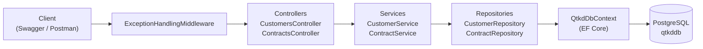
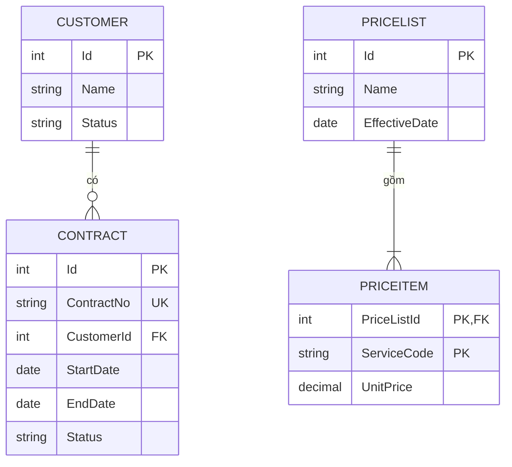

# Sơ đồ thành phần: QTKD (tuần 05)

## 1. Các thành phần chính của solution

| Thành phần | Vai trò |
|---|---|
| Controllers (API) | Nhận HTTP request, gọi Service, trả response/status code |
| Services (nghiệp vụ) | Chứa quy tắc nghiệp vụ; tuần 06 thêm CTR-01..03 và gửi hợp đồng trình duyệt |
| Repositories + Data (truy cập dữ liệu) | Đọc/ghi PostgreSQL qua EF Core |
| Entities / DTOs | Entity ánh xạ bảng; DTO là dữ liệu trả cho client |
| Middleware / Exceptions | Xử lý lỗi thống nhất (404, 500) |

## 2. Mô hình dữ liệu (ERD)

Ghi chú: các trường là gợi ý của đề thực hành, cần đối chiếu với mô hình dữ liệu Phase 1 (xem README mục 7).
